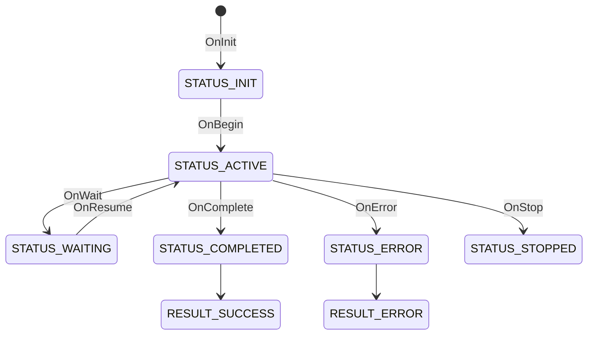

# Avatar State Diagram

## High Level Avatar State Transition

This is not finalized as yet.

```golang

enum AvatarStatus {
  AvatarActionStatusIgnore = 0;
  STATUS_NOT_STARTED = 1;
  // initialized and ready to accept commands
  STATUS_INIT = 2;
  STATUS_ACTIVE = 3;
  STATUS_RERUN = 4;
  STATUS_STOPPED = 5;

  STATUS_COMPLETED = 6;
  // Avatar is waiting for some input or IO
  // or an event
  STATUS_WAITING = 7;
  STATUS_UI_WAITING = 8;
  STATUS_IO_WAITING = 9;
}

enum AvatarResult {
  AvatarActionStatusIgnore = 0;
  RESULT_SUCCESS = 1;
  RESULT_ERROR = 2;
}
```

## High Level Avatar States and Step States


