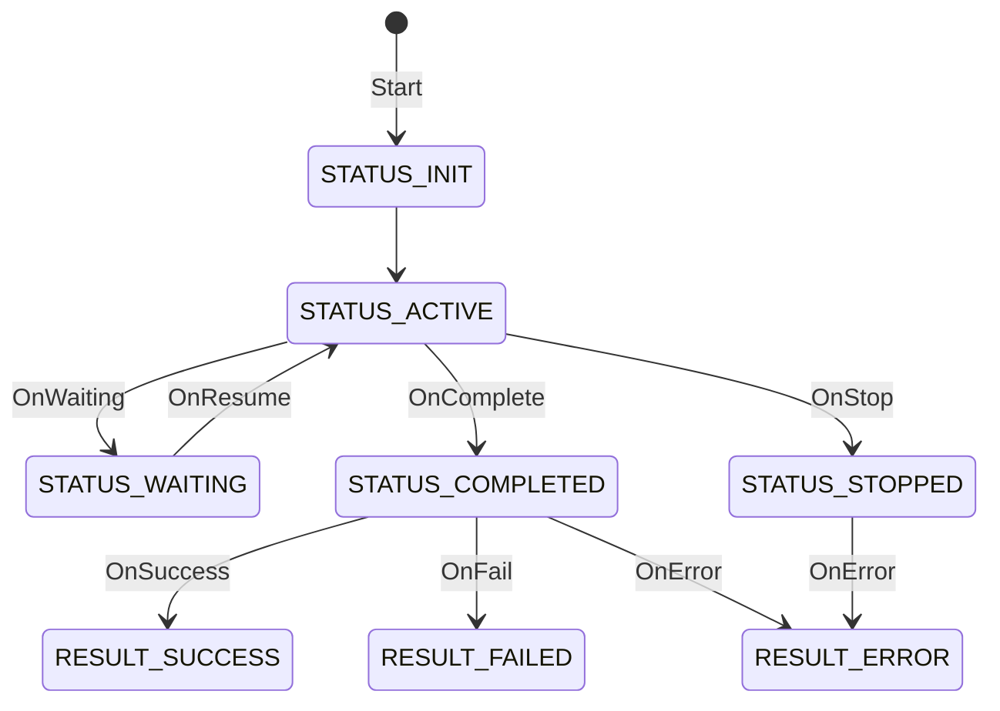
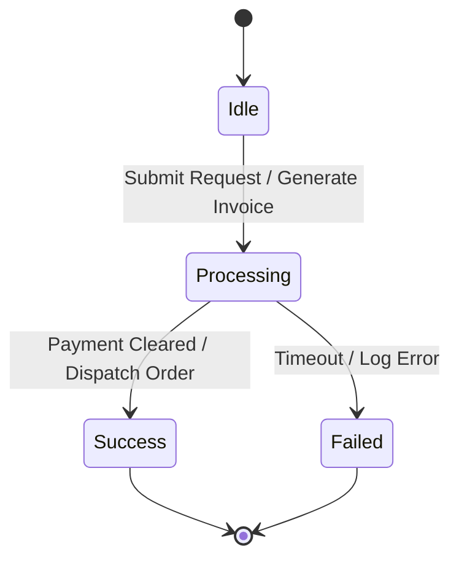

# Avatar State Diagram

## High Level Avatar State Transition

This is not finalized as yet.

```golang
enum AvatarStatus {
  AvatarActionStatusIgnore = 0;
  STATUS_DEFAULT = 1;
  // initialized and ready to accept commands
  STATUS_INIT = 2;

  STATUS_ACTIVE = 3;
  // waiting for user input
  // or some io

  STATUS_RERUN = 4;
    // Avatar is waiting for some input or IO
  // or an event
  STATUS_WAITING =5;
  STATUS_STOPPED = 12;
  STATUS_COMPLETED = 12;
}

enum AvatarResult {
  AvatarActionStatusIgnore = 0;
  RESULT_SUCCESS = 1;
  RESULT_FAILED = 2;
  RESULT_ERROR = 3;
}
```



